# 教师腐蚀强度与视觉可辨识性归因审计（`kinematics.joint_axis`）

- 日期：2026-10-16；代码基线：`00a511a`（`laq/sft-dataset`）
- 范围：`PM_102080`（KitchenPot）、`PM_5088`（Display，阳性对照）、`PM_103275`（Stapler）、`PM_25308`（Table）四个训练集案例，各自对应一个单缺陷 `kinematics.joint_axis` 候选，以及同资产的干净对照。
- 本次**没有**调用任何付费或模型接口，**没有**新增教师采集，**没有**修改原始数据、冻结见证、冻结测试集、审核规则或已有审核记录。新实验只读取既有产物，并重新渲染；渲染结果写入被 gitignore 的 `output/interactive-teacher/corruption-perceptibility-v1/`。仓库内只新增本报告、图片目录 [`teacher-corruption-perceptibility/`](teacher-corruption-perceptibility/)、机读摘要 [`teacher-corruption-perceptibility-audit.json`](teacher-corruption-perceptibility-audit.json)，以及三个脚本。
- 四个案例的冻结 manifest 均为 `in_frozen_test: false`，`split: train`。

## 1. 结论速览

| 问题 | 回答 |
|---|---|
| **当前腐蚀是否过小？** | **以角度衡量并不小**：四个案例的轴误差分别为 55.8°、36.2°、47.8°、59.1°，都在配置区间 30–60° 内。真正决定可见与否的是"关节类型 × 运动行程 × 取景尺度 × 256 px 分辨率"。只有 **PM_102080** 在当前条件下完全不可辨：它是行程仅 0.02 的平移关节，在 256×256 画面中最大投影位移只有 1.8 px，连参考物体自身的运动在正视图中都不产生任何像素变化。PM_25308 当前清晰可辨，但若角度落到 ≤15°，就会退化到边缘可辨。PM_5088 和 PM_103275 的差异远高于可辨阈值。 |
| **增大腐蚀后是否明显可辨？** | **因案例而异。**PM_102080：**否**。角度加到 90°、甚至 180°（方向反转）时，最大投影位移仍 ≤ 2.8 px，2 px 腐蚀后的核心变化 ≤ 0.0003，人眼看不出来；瓶颈在行程而不在角度。PM_25308：**单调变清晰**，5° 时不可辨，15° 时处于边缘，30° 起明确可辨。PM_5088 和 PM_103275：当前角度已远超阈值，继续增大不会带来额外的可辨性。 |
| **当前动作空间是否足以暴露缺陷？** | 对 PM_5088、PM_25308、PM_103275 **足够**：12 个视角加上全部 detent 组合中，分别有 36/48、68/108、101/144 个配对达到可感知规则，而且固定的前视协议本身就包含清晰证据态。对 PM_102080，**任何视角或状态都不足**，0/36。另有两个限制：一是审核只为"有对应参考图"的状态计分，而参考协议只覆盖 front（或 front+oblique_fr），因此动作空间中更优的状态（如 `grazing_front`、`oblique_fl`）既拿不到参考图也不能计分；二是 PM_103275 中 joint_1 的子部件位于固定取景的右缘，部分运动被裁出画面（见 §4.3）。 |
| **教师是没获得清晰证据，还是看到后仍理解错误？** | **PM_102080 是"没获得、也无法获得"**：12 个合法判定全部是 `uncertain`，这是正确且可信的行为。**另外三个案例中，除一个 episode 外，教师都获得了清晰证据**（目检为 A 级，见 §2.4）。失败主要来自两类：**③ 看到后判 pass/uncertain/错类型**（9 个），以及 **④ 类型正确但部件或证据引用错误**（14 个）。只有 1 个 episode（PM_103275 r5-active）属于 ② 教师自己没走到清晰状态。 |

规则化归因计数（只计合法终判；`no_legal_verdict` 为网关错误或空响应，单列）：

| 案例 | 合法终判 | ✅ correct_fail | ① 腐蚀不可辨 | ② 覆盖不足 | ③ 有证据仍误判 | ④ 定位/引用错 | 无合法终判 |
|---|---:|---:|---:|---:|---:|---:|---:|
| PM_102080 | 12 | 0 | **12** | 0 | 0 | 0 | 0 |
| PM_5088 | 12 | **8** | 0 | 0 | 2 | 2 | 8 |
| PM_103275 | 13 | 0 | 0 | 1 | 2 | **10** | 5 |
| PM_25308 | 14 | **7** | 0 | 0 | **5** | 2 | 4 |
| 合计 | 51 | 15 | 12 | 1 | 9 | 14 | 17 |

同资产干净对照共 38 个 episode，全部审核结论是 `uncertain_on_clean`（20）、`pass_on_clean`（9）或 `no_legal_verdict`（9），**没有一例 `false_fail_on_clean`**。也就是说，在这四个资产上没有观察到教师"无中生有"报缺陷。

## 2. 方法

### 2.1 复核的既有记录

| 记录 | 路径 | 用途 |
|---|---|---|
| 准备好的 gold 行 | `data/benchmarks/partnet-mobility-formal-v1/prepared/train.gold.jsonl`（sha256 `cbb1e22e…0dab7`） | 候选与参考程序、`program_sha` / `reference_sha`、腐蚀发现 |
| 原始样本 | `data/benchmarks/partnet-mobility-formal-v1/raw/shard-0000.tar`（sha256 `9d83f978…27d95`） | `CorruptionSpec`（含 `angle_deg`、`original_axis`、腐蚀后轴 `label.axis`）与取景 `framing` |
| 资产目录 | `data/assets/partnet-mobility-trainval-v1/catalog.json`（sha256 `c0a2f251…d6423`） | 干净 `AssetSpec`，用于重建参考与梯度候选 |
| 冻结见证 | `output/interactive-teacher/axis-round4-frozen-witnesses/<id>/manifest.json` | 冻结的候选像素、参考协议图、可感知层级 |
| 教师 episode | `output/interactive-teacher/kimi-round{2..5}-*/episode.json` 与 `observations/`、`reference-*.png`、`model_calls/*/response.txt` | 教师实际看到的图片、动作和原始判定 |
| 独立审核 | 每个 episode 旁的 `audit.correctness-v1.json`（2026-10-16 第 2–5 轮全量重审，见 [`kimi-round2-5-correctness-reexport.json`](kimi-round2-5-correctness-reexport.json)） | 审核结论、驳回原因、逐步证据绑定 |
| 先前可辨识性测量 | [`kimi-interactive-teacher-round4-diagnosis.json`](kimi-interactive-teacher-round4-diagnosis.json) 的 `discriminability` | 与本次数值交叉核对；本次在 front/oblique_fr 上重算的数值与之一致，例如 PM_5088 front/limit 的变化比例同为 0.2081 |

四个腐蚀案例共 68 个 episode，四个干净对照共 38 个，**全部**都有 `audit.correctness-v1.json`。

### 2.2 离线实验（`scripts/sweep_corruption_perceptibility.py`）

1. **身份校验**：从资产目录读取干净 spec，`ObjectProgram.from_spec(spec)` 必须复现 gold 的 `reference_sha`；把 joint 轴替换为原始样本中记录的 `label.axis` 后，必须复现 gold 的 `program_sha`。四个案例全部通过。
2. **全动作空间扫描**（当前腐蚀）：渲染 12 个视角（`configs/views.yaml`，即教师 `context.views` 的全部选项），覆盖每个关节所有可达 detent（rest/zero/mid/limit，按实际值去重）的笛卡尔积。候选与参考在**同一状态、同一取景、同一 256×256 分辨率**下逐对比较。扫描结果与冻结见证中所有对应状态的候选 PNG **逐字节一致**（分别验证 6、8、12、10 个见证）。
3. **强度梯度**：沿原始轴到腐蚀轴所在的同一垂直方向旋转，取 0°、5°、15°、30°、45°、60°、90°、180°，并保持物体、取景、视角（front、oblique_fr）、全部状态和分辨率不变。0° 必须与参考完全一致，实测四例均为 0 差异。90° 与 180° 超出配置区间，只作为极端对照。
4. **确定性**：重跑 PM_102080 后，`summary.json` 中该案例的全部内容（含每张 PNG 的 SHA-256）完全一致。

### 2.3 指标

| 指标 | 定义 | 注意 |
|---|---|---|
| `changed_fraction`（chg） | 候选与同状态参考的逐像素最大通道差 > `ExposureThresholds().pixel_delta` 的像素比例 | 1 px 的描边错位也会计入 |
| `core_changed_fraction`（core） | 上述掩码经 5×5 腐蚀（半径 2 px）后剩余的比例，即仓库现有的"可感知"代理；规则阈值为 core ≥ 0.001 | 只衡量厚度，不衡量语义 |
| 最大连续核心区域（region） | 腐蚀后最大连通块的像素数 | 用来区分"一大块"和"满屏碎点" |
| 几何位移 `world_max` / `px_max` | 浏览器导出的世界坐标顶点逐点距离的最大值，以及按 `web/src/camera.ts` 同一相机投影到 256 px 画面后的最大像素位移 | 位移可能落在画面外或被遮挡，因此 **px 位移大 ≠ 可见差异大**（见 PM_103275 limit） |
| 参考运动（motion） | 同视角下参考在该状态与 rest 状态之间的 `changed_fraction` | 衡量关节运动本身是否可见 |

### 2.4 可辨识性目检分级（像素差异 ≠ 语义可辨）

在 §4 的图片上，按原生 256 px 分辨率给出三级判断：

- **A 清晰**：形状、姿态或部件位置有明确且语义可解释的差异，不需要放大。
- **B 可见但弱或含糊**：放大后能看到局部差异，但不足以单独支撑"轴方向错误"这一语义结论。
- **C 不可辨**：差异只是 1–2 px 的描边或抗锯齿。

> **待验证**：目检由本次审计的 AI 审计者完成，**不是**人类被试实验。A/B/C 分级应由合作者对照 §4 的图片人工复核；本报告不把它当作人类可辨识性的统计结论。

### 2.5 归因规则（`scripts/collect_teacher_perceptibility.py`）

对每个合法终判的腐蚀 episode，按顺序判定：

1. `correct_fail` → 正确。
2. 动作空间中没有任何配对达到可感知规则 → **①**。
3. 教师轨迹中没有任何"已绑定冻结像素、有对应参考图、并达到可感知规则"的步骤 → **②**。
4. 有上述计分证据，但判定为 pass/uncertain，或缺陷类型错误 → **③**。
5. 缺陷类型正确，但 joint/parts 与 gold 不符，或引用了没有计分证据的步骤 → **④**。

规则归因依赖像素代理；§4 用目检逐案确认或修正。

## 3. 案例总览

| 案例 | 关节（类型，范围） | 轴误差 | 取景半径 | 动作空间可感知配对 | 动作空间最优状态（core / 位移） | 教师实际访问的最优状态（core） | 目检结论 |
|---|---|---:|---:|---:|---|---|---|
| PM_102080 KitchenPot | `joint_0` prismatic，[0, 0.02] | 55.8° | 1.441 | **0/36** | oblique_fr limit：0.0000 / 1.8 px | 0.0000 | **C**：所有视角与状态都不可辨 |
| PM_5088 Display | `joint_0` revolute，[−0.251, 0.773] | 36.2° | 1.012 | 36/48 | grazing_front limit：0.2793 / 73.8 px | F 与 F+O 均为 front limit 0.1837 | **A**：zero/mid/limit 状态下屏幕都明显倾斜或分离 |
| PM_103275 Stapler | `joint_1` revolute，[−0.119, 3.387] | 47.8° | 1.003 | 101/144 | grazing_front（joint_0=limit, joint_1=mid）：0.2358 / 241 px | F：front joint_1=mid 0.0796；F+O：oblique_fr joint_1=mid 0.0867 | zero 与 mid 为 **A**，limit 为 **B** |
| PM_25308 Table | `joint_1` prismatic，[0, 0.44] | 59.1° | 1.090 | 68/108 | oblique_fl joint_1=limit：0.0535 / 58.2 px | F：front joint_1=limit 0.0313；F+O：oblique_fr joint_1=limit 0.0332 | mid 与 limit 均为 **A**（抽屉缩回或斜出） |

## 4. 逐案例证据与结论

图中每个关键面板依次为：同状态参考图 | 当前腐蚀候选图 | 差异热图（浅色底面表示低于曝光阈值；蓝色越深差异越大，|Δ| ≥ 0.25 时饱和；淡灰为参考轮廓） | 参考局部放大 | 候选局部放大（橙框为最大差异连通区域，最近邻放大）。所有瓦片都是渲染器或教师 episode 的原始 PNG，没有做任何修饰。

### 4.1 PM_102080（KitchenPot）——① 腐蚀在当前关节上视觉投影不可辨

**数值**：在 front 与 oblique_fr 视角下，mid/limit 状态的 chg 为 0.0053–0.0177，core 全部 ≤ 0.00005，最大核心区域 ≤ 3 px，最大投影位移 0.7–1.8 px，世界位移 0.009–0.019。其余 10 个视角同样为 0/3 可感知。**参考物体自身**在 front 视角下 rest/mid/limit 三张参考图的 SHA 完全相同（`3409b5ee…`），即运动本身就不可见。

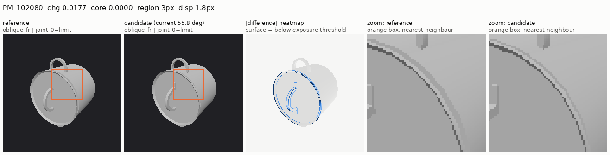

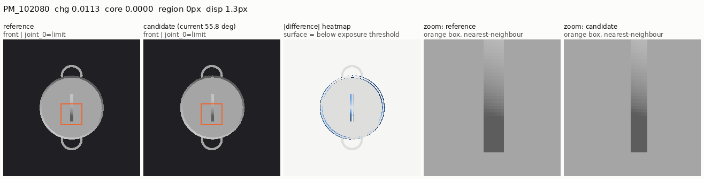

**全视角对比**：12 个视角在 limit 状态下的差异都只是锅盖边缘 1–2 px 的细线。

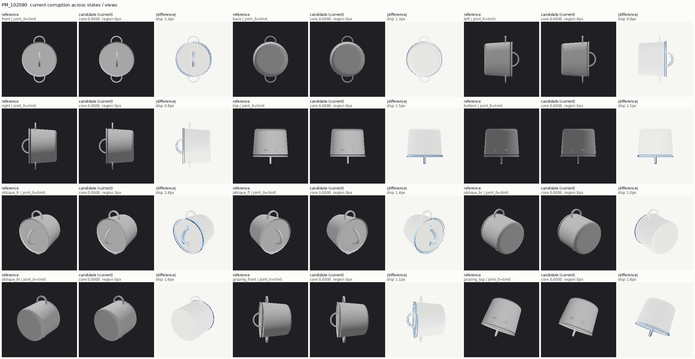

**强度梯度**（oblique_fr，limit）：

| 角度 | chg | core | 最大核心区域 | 投影位移 | 世界位移 |
|---:|---:|---:|---:|---:|---:|
| 0° | 0.0000 | 0.0000 | 0 | 0.0 px | 0.000 |
| 5° | 0.0014 | 0.0000 | 0 | 0.1 px | 0.002 |
| 15° | 0.0046 | 0.0000 | 0 | 0.5 px | 0.005 |
| 30° | 0.0095 | 0.0000 | 0 | 1.0 px | 0.010 |
| 45° | 0.0145 | 0.0000 | 0 | 1.5 px | 0.015 |
| 55.8°（当前） | 0.0177 | 0.0000 | 3 | 1.8 px | 0.019 |
| 60° | 0.0188 | 0.0001 | 3 | 2.0 px | 0.020 |
| 90° | 0.0253 | 0.0003 | 9 | 2.7 px | 0.028 |
| 180° | 0.0257 | 0.0002 | 4 | 2.8 px | 0.040 |

图中只展示了 0°、30°、当前、60°、90°、180° 这几个角度；表中所有数值均取自 `summary.json`。

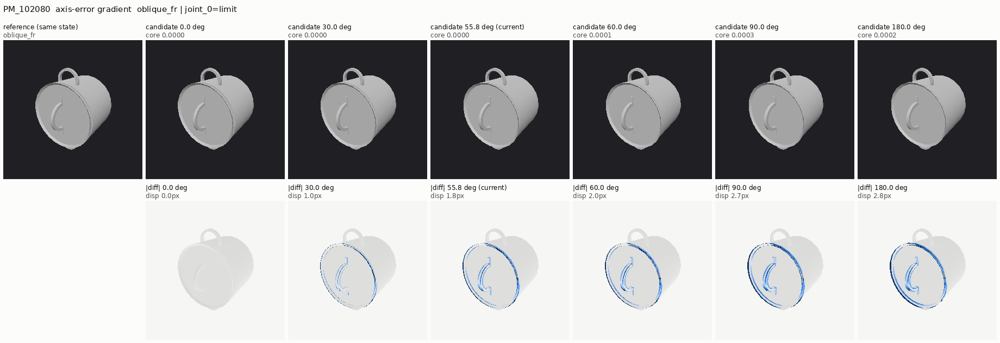

**原因**：平移量上界为 `2·sin(θ/2)·0.02 ≤ 0.04`。正交视角下每单位长度约 256/(2.2×1.441) ≈ 81 px，因此位移 ≤ 3.2 px，与实测一致。增大角度在物理上就不可能超过约 3 px。

**教师**：12 个合法终判全部是 `uncertain`，置信度 0.4–0.6，审核结论均为 `trustworthy_uncertain`。其中 `kimi-round2-insufficient-axis-pm102080` 另因 `frozen_manifest_sha_or_content_mismatch` 被阻止导出。

**结论**：属于 **①**。教师"不确定"是正确行为，不是能力缺陷。这个样本不应作为 `joint_axis` 的阳性监督。

### 4.2 PM_5088（Display，阳性对照）——证据清晰；失败集中在加入斜视参考的条件

**数值**（当前 36.2°）：front 视角下 zero、mid、limit 的 core 分别为 0.0246、0.0215、0.1837，最大核心区域 1507、1343、12007 px，投影位移 18.0、17.6、46.8 px；oblique_fr 视角下 core 分别为 0.0789、0.1214、0.1125。

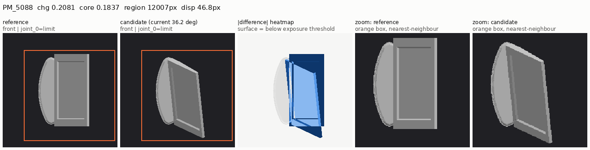

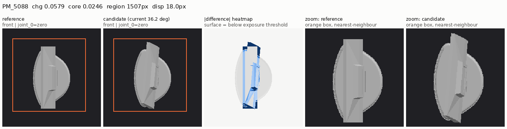

**强度梯度**（front，limit）：

| 角度 | chg | core | 最大核心区域 | 投影位移 | 世界位移 |
|---:|---:|---:|---:|---:|---:|
| 0° | 0.0000 | 0.0000 | 0 | 0.0 px | 0.000 |
| 5° | 0.1780 | 0.1514 | 9925 | 5.0 px | 0.073 |
| 15° | 0.2025 | 0.1867 | 12235 | 16.6 px | 0.222 |
| 30° | 0.2100 | 0.1934 | 12676 | 37.3 px | 0.451 |
| 36.2°（当前） | 0.2081 | 0.1837 | 12007 | 46.8 px | 0.545 |
| 45° | 0.2146 | 0.1966 | 12883 | 60.8 px | 0.675 |
| 60° | 0.2134 | 0.1906 | 12488 | 85.2 px | 0.880 |
| 90° | 0.2145 | 0.1763 | 11553 | 128.0 px | 1.193 |
| 180° | 0.2981 | 0.2579 | 16905 | 121.7 px | 1.095 |

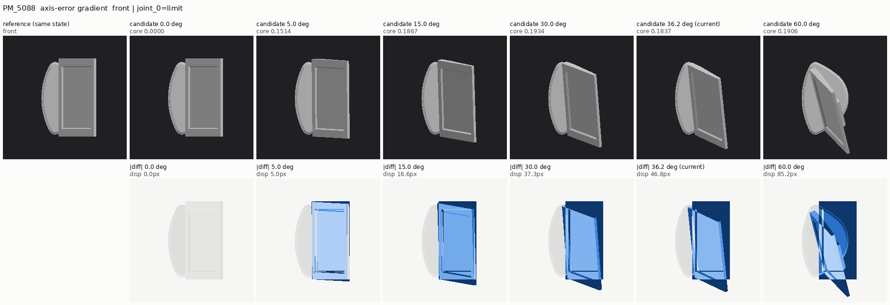

**像素与语义的反例**：5° 时 core 已经达到 0.15，但几何位移只有 5 px。热图显示，变化主要来自整块屏幕的**明暗变化**（法向改变导致着色改变），而不是形状改变。目检看，5° 时只能看出"屏幕略暗、略斜"，难以据此断定是轴方向错误（B 级）；≥ 15° 时倾斜明确（A 级）。因此 core 规则在大面积平面部件上会**高估**语义可辨性。

**教师实际收到的图片**（`kimi-round4-fixed-MH-pm5088-axis-rep2`，第 2、4、7、9 步与对应参考）：屏幕的倾斜和分离一目了然，教师却以 0.85 的置信度判为 `pass`，理由是 "No kinematic, structural, or geometric discrepancy is evident in any comparable reference/observation pair"。

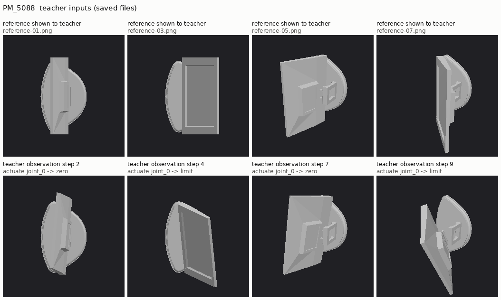

**结论**：12 个合法终判中 8 个正确。2 个属于 **③**，目检确认（M-r2 判 `uncertain`，MH-rep2 判 `pass`），两者都收到了 A 级证据。2 个属于 **④**（A、M-rep2）：parts 为 `link_0, link_1`；按 hierarchy `base→link_1→joint_0→link_0`，`link_1` 是父部件，属于定位错误。两个 ③ 都出现在加入 oblique_fr 参考的 M/MH 条件下（见 §5.2）。

### 4.3 PM_103275（Stapler）——证据清晰；主要失败是部件定位和证据引用（④）

**数值**（当前 47.8°，joint_0 处于 rest）：

| 状态 | 视角 | chg | core | 最大核心区域 | 投影位移 | 参考运动 | 目检 |
|---|---|---:|---:|---:|---:|---:|---|
| joint_1=zero | front | 0.0190 | 0.0056 | 366 | 15.1 px | 0.0040 | A：杆体明显倾斜 |
| joint_1=mid | front | 0.0962 | 0.0796 | 5215 | 154.6 px | 0.0466 | A：link_1 向右下大幅甩出，部分越出画面 |
| joint_1=limit | front | 0.0070 | **0.0006** | 15 | 44.0 px | 0.0425 | **B**：只在右端铰链处出现杂乱纹理 |
| joint_1=limit | oblique_fr | 0.0088 | 0.0013 | 85 | 51.4 px | 0.1208 | B |

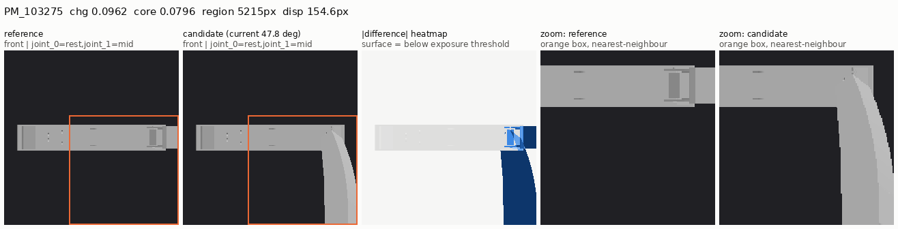

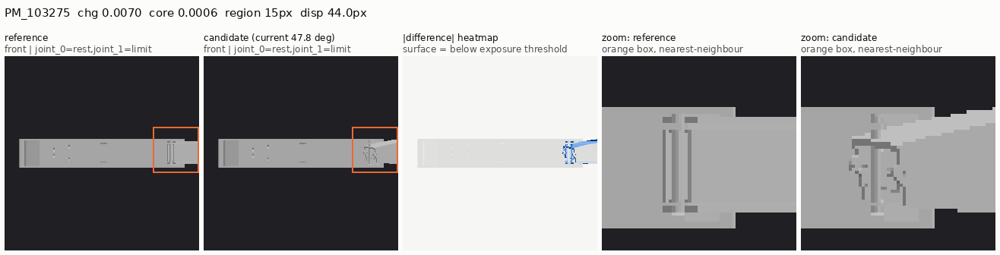

**不同关节位置与视角**：limit（约 194°）接近半圈，候选与参考的投影大致重合；而且 joint_1 的子部件位于固定取景的右缘，参考长条本身已经顶到画面边界，于是 44 px 的几何位移只留下 15 px 的核心差异。mid 状态或 grazing_front、right 等视角更清晰。

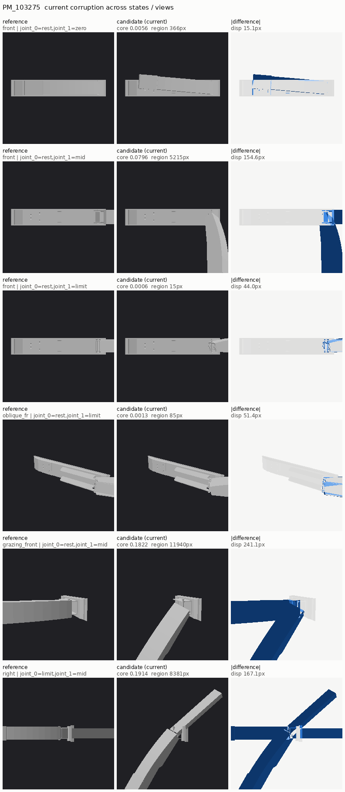

**强度梯度**（front，joint_0=rest，joint_1=mid）：

| 角度 | chg | core | 最大核心区域 | 投影位移 | 世界位移 | 目检 |
|---:|---:|---:|---:|---:|---:|---|
| 0° | 0.0000 | 0.0000 | 0 | 0.0 px | 0.000 | 与参考一致 |
| 5° | 0.0284 | 0.0202 | 1315 | 18.3 px | 0.158 | A/B 边界：右端出现小段弯折 |
| 15° | 0.0505 | 0.0412 | 2700 | 55.0 px | 0.474 | A |
| 30° | 0.0801 | 0.0664 | 4349 | 106.3 px | 0.938 | A |
| 45° | 0.0954 | 0.0786 | 5031 | 148.2 px | 1.374 | A |
| 47.8°（当前） | 0.0962 | 0.0796 | 5215 | 154.6 px | 1.451 | A |
| 60° | 0.1015 | 0.0867 | 5680 | 176.2 px | 1.767 | A |
| 90° | 0.0875 | 0.0708 | 4642 | 196.9 px | 2.385 | 未单独目检（图中未展示） |
| 180° | 0.0208 | 0.0103 | 580 | 75.9 px | 2.940 | 未单独目检（图中未展示） |

0°→60° 时 core 单调上升。90° 与 180° 时，世界位移继续增大而像素差异回落，说明运动部件越出画面或与参考投影重叠，这再次表明几何位移不等于可见差异。

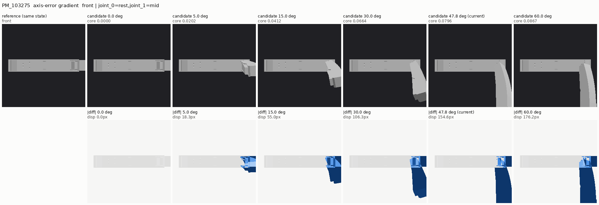

**教师实际收到的图片**（`kimi-round4-active-HC-pm103275-axis-r2`，第 4 步 joint_1→limit，第 5 步 joint_1→mid）：

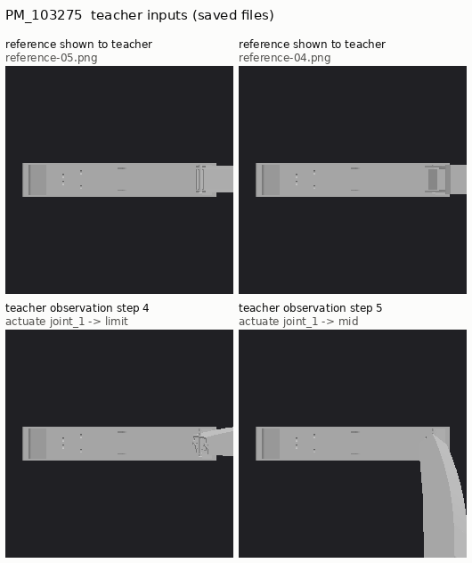

教师原话："Actuating joint_1 swings link_1 into a large out-of-plane rotation (mid pose bends the right end downward ~90 degrees; limit folds it back)…"。类型（`joint_axis`）、关节（`joint_1`）、部件（`link_1`）**全部正确**，但证据步同时引用了第 4 步（limit，B 级，core 0.0006，未计分）和第 5 步（mid，A 级，已计分）。审核要求"引用的每一步都有计分证据"，因此以 `finding_lacks_cited_counterfactual_evidence` 驳回。

**10 个 ④ 的分解**（全部为类型和关节正确）：

| 子类型 | 数量 | Episode | 说明 |
|---|---:|---|---|
| parts 多报父部件 `link_2` | 4 | r3-active、r3-fixed、A、A-rep2 | hierarchy 为 `base→link_2→joint_1→link_1→joint_0→link_0`，`link_2` 是静止父部件，属于定位错误 |
| parts 多报随动孙部件 `link_0` | 2 | H、H-rep2 | `link_0` 确实随 joint_1 运动；按 gold 只认直接子部件的约定判错，可以讨论 |
| parts 完全正确，但额外引用了 limit 步（B 级） | 4 | HC-r2（active）、HC-rep1、HC-rep2、r5-fixed | 仅因引用规则被驳回 |

部件错误的 6 例中，r3-fixed、A-rep2、H、H-rep2 这 4 例同时也引用了 limit 步。包括 r5-active 在内，所有"未计分的引用步"都是 front 视角、joint_1=limit 这一状态。

**另一类失败**：`kimi-round5-active-pm103275-axis-r1` 中教师只走了 front→joint_1:limit 就下结论，从未访问 A 级的 mid 状态，按规则归为 **②**（教师选择了弱状态，而动作空间本身足够）。2 个 **③**（M-r2 判 `pass`，MH-rep2 判 `uncertain`）都收到了 A 级的 mid 状态图片，教师却称"visually match the corresponding reference states"，目检确认为看到后仍误判。

**结论**：PM_103275 **不是**腐蚀太弱。教师在 11/13 个合法终判中正确识别了缺陷类型和关节，失败主要在 **④**：早期轮次是部件定位错误；加入部件约定提示（HC、AR）后部件正确，但教师引用了弱证据步。若把引用规则放宽为"至少一个引用步有计分证据"，HC-r2、HC-rep1、HC-rep2、r5-fixed 这 4 个 episode 会变成 `correct_fail`。**这只是反事实分析**：本次没有修改审核规则或审核记录；是否放宽属于协议决策，**待合作者讨论**。

### 4.4 PM_25308（Table）——证据清晰；腐蚀强度存在明确梯度；③ 最多

**数值**（当前 59.1°，joint_0 处于 rest）：front 视角下 joint_1=mid 的 core 为 0.0062（最大核心区域 408 px，位移 21.7 px），joint_1=limit 为 0.0313（1587 px，43.4 px）；oblique_fr limit 为 0.0332；动作空间最优为 oblique_fl limit，0.0535。目检：在参考物体中，抽屉沿正视图水平向左拉出；在候选中，mid 状态下抽屉几乎完全缩进桌体，limit 状态下向左上方斜出。两者均为 **A**。

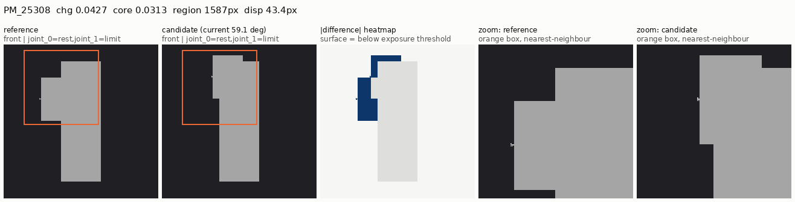

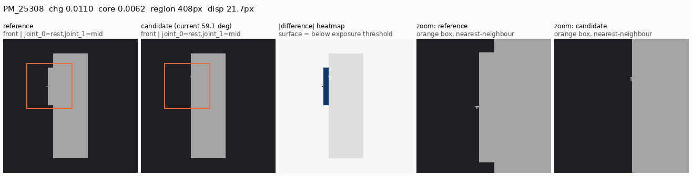

**不同视角**：front、oblique_fr、oblique_fl、top 视角下都清晰；oblique_fl 的差异最大，但参考协议中没有这个视角的参考图，因此无法计分。

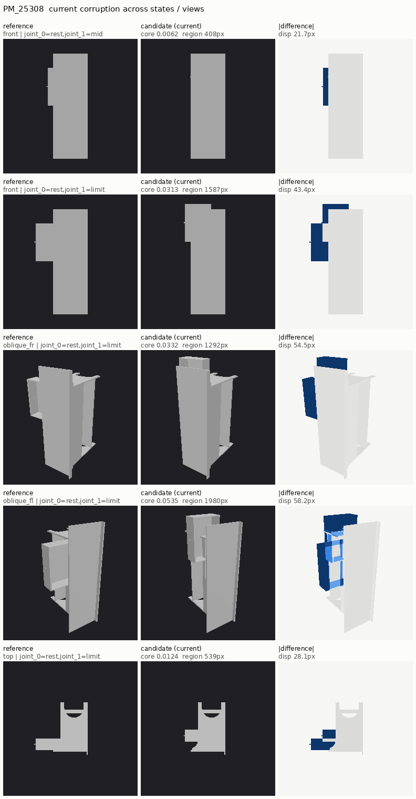

**强度梯度**（front，joint_1=limit；这是四个案例中最有代表性的梯度）：

| 角度 | chg | core | 最大核心区域 | 投影位移 | 世界位移 | 目检 |
|---:|---:|---:|---:|---:|---:|---|
| 0° | 0.0000 | 0.0000 | 0 | 0.0 px | 0.000 | 与参考一致 |
| 5° | 0.0042 | 0.0000 | 0 | 3.7 px | 0.038 | C：抽屉上下沿出现细线 |
| 15° | 0.0129 | 0.0065 | 232 | 11.2 px | 0.115 | B：抽屉略微上移，需要对照才能看出 |
| 30° | 0.0252 | 0.0157 | 592 | 22.4 px | 0.228 | A |
| 45° | 0.0354 | 0.0240 | 1142 | 33.4 px | 0.337 | A |
| 59.1°（当前） | 0.0427 | 0.0313 | 1587 | 43.4 px | 0.434 | A |
| 60° | 0.0430 | 0.0315 | 1632 | 44.0 px | 0.440 | A |
| 90° | 0.0483 | 0.0383 | 1972 | 63.7 px | 0.622 | A：抽屉竖直向上 |
| 180° | 0.0847 | 0.0716 | 2720 | 94.0 px | 0.880 | A：抽屉向右拉出 |

在 front 与 oblique_fr 两个视角的全部 18 个配对中，达到可感知规则的配对数随角度依次为：5° 0/18、15° 6/18、30° 9/18、45° 及以上 12/18。

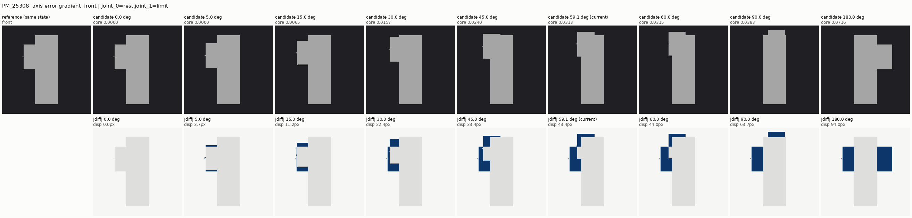

**教师实际收到的图片**（`kimi-round4-fixed-HC-pm25308-axis-rep2`，第 5、6 步与参考 03、04）：差异肉眼可见，教师却以 0.55 的置信度判为 `uncertain`，称 "broadly consistent with the reference states, … so no front-view kinematic defect is supported"。

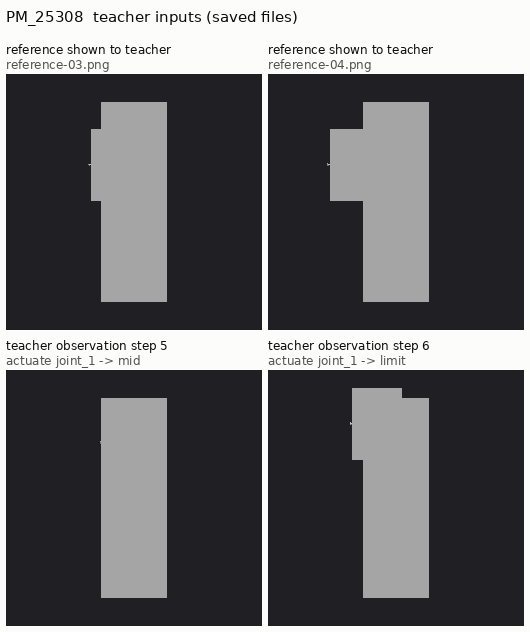

**结论**：14 个合法终判中 7 个正确。5 个 **③**：其中 4 个判 `uncertain`（HC-r2 active、HC-rep2、M、MH），在总结中都明确说 joint_1 与参考"consistent"，目检确认它们都收到了 A 级证据，属于感知层面的漏看，而不是校准过度保守。第 5 个是 `kimi-round3-fixed-pm25308-axis`，判为 `joint_range`：教师的描述（"mid produces no visible displacement and limit only reaches a mid-like pose"）其实准确描述了投影现象。在单一正交前视中，倾斜的平移轴会投影为"行程缩短加上竖直偏移"，因此这一例应理解为**投影歧义导致的类型错误**。2 个 **④**：parts 报成静止的 `link_2`。

## 5. 综合分析

### 5.1 四类失败的边界

- **① 腐蚀太弱或视觉投影不可辨**：只有 PM_102080（12/12）。根因是"行程 × 取景尺度 × 分辨率"太小，增大轴误差无效。现有的可感知层级（`perceptible_support` 为空）已经正确地拒绝把它当作阳性证据。
- **② 动作空间或观察状态覆盖不足**：动作空间本身没有在任何可辨案例上成为瓶颈。唯一一例 ② 是教师自己只访问了 B 级状态（PM_103275 r5-active）。结构性限制在于"可计分的状态"和"有参考图的状态"只覆盖 front（或 front+oblique_fr）协议，以及取景是固定的；这会排除更优视角，但在本组案例里**不是**失败的主因。
- **③ 证据清晰但仍误判**：共 9 例，分布于 PM_5088（2）、PM_103275（2）、PM_25308（5）。其中 8 例为 pass/uncertain，并声称"与参考一致"；1 例是投影歧义下的类型错误。
- **④ 类型正确但定位或引用错误**：共 14 例。部件错误 10 例：把静止的父部件报入（多报或替代）8 例，其中 PM_5088 2 例、PM_103275 4 例、PM_25308 2 例；多报随动孙部件 2 例（PM_103275）。另有 4 例部件完全正确，只因引用了 B 级步而被驳回，都在 PM_103275。

### 5.2 待验证的观察：加入斜视参考后漏判上升

在三个可辨案例中，只用前视参考（F）的条件下合法终判 30 个，其中 14 个 correct_fail，③ 只有 3 个；加入 oblique_fr 参考与观察（F+O，即 M/MH）后合法终判 9 个，只有 1 个 correct_fail，③ 达到 6 个。已核实的伴随差异有两项：一是最后一次调用中的图片数，F 条件为 6–13 张（参考加观察），F+O 条件为 17–27 张；二是网关或空响应失败率，F 为 10/40，F+O 为 7/16。可能的解释包括图片数增加后注意力被稀释，以及 oblique_fr 中参考物体自身的运动大于缺陷信号（如 PM_5088 oblique_fr mid 状态下，参考运动为 0.1818，缺陷 chg 为 0.1500）。**样本很小，F+O 条件下的失败率也更高，这只是相关性观察，待受控复现验证**。本次没有新增调用来检验它。

### 5.3 对数据工程的直接含义

1. **在生成侧过滤不可辨的关节**：对每个 `joint_axis` 候选，如果动作空间中所有配对都不满足可感知规则（或参考运动本身为 0），就不应作为阳性监督。PM_102080 这类小行程平移关节应排除，或改用其他缺陷类型，而不是加大角度。
2. **轴误差下限**：以 PM_25308 为例，≤ 15° 时会降到边缘可辨。配置下限 30° 合理，不建议下调。
3. **可感知规则需要补充语义检查**：core 规则会把大面积平面的着色变化（PM_5088 5°）计为强证据。建议增加基于几何位移的条件，例如要求 px 位移 ≥ 若干像素，并且在画面内。具体阈值**待人工标注校准**。
4. **取景**：PM_103275 的运动部件贴近画面边缘。固定取景是否应包含全部检测状态下的包围盒，**待验证**。这会改变冻结协议，必须走 `docs/protocol.md` 流程。

## 6. 无法由现有记录证明、需要标注为"待验证"的判断

- A/B/C 目检分级是 AI 审计者的判断，不代表人类可辨识性；需要人工复核，或做小规模人类标注。
- §5.2 中 F+O 条件与漏判的关联，以及背后的原因（图片数量还是参考运动的显著性）。
- 把引用规则放宽到"至少一步计分"、或允许随动后代部件之后，导出数据是否仍然可靠，属于协议决策。
- 扩大取景能否在 PM_103275 的 limit 状态下把 B 级证据提升为 A 级（需要改变冻结协议才能实测）。
- 教师内部是否"看见了但没说"：现有记录只有最终输出文本，无法区分感知失败与推理或校准失败；本报告的 ③ 只能确认"收到了 A 级证据却给出了与之矛盾的结论"。
- 本报告的结论只覆盖这四个资产、一个缺陷类型和一个教师模型（`k3-256k`），不外推到其他资产或模型。

## 7. 复现命令

```bash
# 1) 动作空间扫描与强度梯度（离线 Chromium，无 API 调用）
python -m scripts.sweep_corruption_perceptibility \
  --sample-id b124e209888e8e2e692ad38a --sample-id 78daaf49b71ff5f5df8a1a29 \
  --sample-id ec3acb502c61937e9b968ab1 --sample-id 27d942cd3de2d333f24d6279 \
  --angles 0 5 15 30 45 60 90 180 \
  --out output/interactive-teacher/corruption-perceptibility-v1

# 2) 关联教师 episode、独立审核与扫描结果，写出机读摘要
python -m scripts.collect_teacher_perceptibility \
  --sweep output/interactive-teacher/corruption-perceptibility-v1/summary.json \
  --clean-id PM_102080=87873dda7b4e005dd094bb8e --clean-id PM_5088=db9a74ccfe15b03ea4f01dee \
  --clean-id PM_103275=d9fc43da657845082fc3198a --clean-id PM_25308=d631d4336c087d9850cf1d31 \
  --out docs/evidence/teacher-corruption-perceptibility-audit.json

# 3) 由已保存的 PNG 合成报告图片，并写出来源与哈希清单
python -m scripts.render_perceptibility_figures \
  --sweep output/interactive-teacher/corruption-perceptibility-v1/summary.json \
  --out docs/evidence/teacher-corruption-perceptibility
```

产物哈希：

| 产物 | sha256 |
|---|---|
| `output/interactive-teacher/corruption-perceptibility-v1/summary.json` | `4d2e45fadcd219b61c717f0f36a267a34558b6ebd31eba989a53082f6e8f667e` |
| `docs/evidence/teacher-corruption-perceptibility-audit.json` | `eed4cc6d06a95efbcc778da32b8eaa51a526738209104bbe41433d2a5656d578` |
| `docs/evidence/teacher-corruption-perceptibility/figures.json` | `fc8891c4995027181ffcf5badd1d968b0989cc515569ee5abbb5074761ff13aa` |
| `axis-round4-frozen-witnesses/b124e209…/manifest.json`（PM_102080） | `6de41ab08bfaf4eb6aa77830e34402e179137dc868841a6052e33b6cae801028` |
| `axis-round4-frozen-witnesses/78daaf49…/manifest.json`（PM_5088） | `0ca566968dfcdec819de767ec630dc5131afff5530a7cfa4e1c3b57bdec40d00` |
| `axis-round4-frozen-witnesses/ec3acb50…/manifest.json`（PM_103275） | `bc842af2754cb9703058305f0c73e70c8de2afe629d1d05832808dc5b9ddb751` |
| `axis-round4-frozen-witnesses/27d942cd…/manifest.json`（PM_25308） | `05e4a9f40a1ef7790cbb74304576791f623c2c3cedf5ac193410b7cda4bbaa80` |

## 8. 图片来源与哈希

每张图的输入 PNG 路径及其 SHA-256 逐一记录在 [`teacher-corruption-perceptibility/figures.json`](teacher-corruption-perceptibility/figures.json) 的 `sources` 中。`key_panel`、`gradient`、`state_grid` 的来源是第 1 步扫描写出的渲染图，候选部分已与冻结见证逐字节核对；`teacher_view` 的来源是对应 episode 目录中教师实际收到的 `reference-*.png` 与 `observations/*.png`。

| 图片 | 类型 | sha256 | 来源 PNG 数 |
|---|---|---|---:|
| `PM_102080__key__oblique_fr__joint_0-limit.png` | key_panel | `eb8189c600d4b904e70a764c8daaebfa9ef08354e25780e5a441157c051f5d73` | 2 |
| `PM_102080__key__front__joint_0-limit.png` | key_panel | `5ca730f06239b5e5a3ca921b90532dbbd7a1ec713173d1e68054d9d2df82c09d` | 2 |
| `PM_5088__key__front__joint_0-limit.png` | key_panel | `41a02c702d6c1bb9d1310360c5243056e186006dc4b1c9b8caed14c73ccbebe6` | 2 |
| `PM_5088__key__front__joint_0-zero.png` | key_panel | `a7f9ba7cd8a16429101a98a91a8338e62351a6dd09d852370a7e519411251519` | 2 |
| `PM_103275__key__front__joint_0-rest__joint_1-mid.png` | key_panel | `5e08f8225f7b6509f0bfb76e64c182b6d8cc22498f6dfe098efd026ddb8e9668` | 2 |
| `PM_103275__key__front__joint_0-rest__joint_1-limit.png` | key_panel | `2846000d60a2496c280754d56c6ca4d7e7ba8bea33993acd6572fd44760396f5` | 2 |
| `PM_25308__key__front__joint_0-rest__joint_1-limit.png` | key_panel | `9f76b1bd36ebe14c6e1619969523e55475ba481ab15e4703d0204861bb40fac7` | 2 |
| `PM_25308__key__front__joint_0-rest__joint_1-mid.png` | key_panel | `438c6c961781c1764049bd545eb54b2a1543c04958970206fdd58580574075be` | 2 |
| `PM_25308__gradient__front__joint_0-rest__joint_1-limit.png` | gradient | `0a3493b9d19d49cbe092d6bb28568b06a12a949d7e2a6d04779e93117f907029` | 10 |
| `PM_102080__gradient__oblique_fr__joint_0-limit.png` | gradient | `782063a58e4495aa4c01095a0ae107dbd28257bcd57d8ea803cdf4716f8d3e56` | 7 |
| `PM_5088__gradient__front__joint_0-limit.png` | gradient | `689c3bebe421b2d82b0f0721e44202db138fa015529c69db690d496963030cc2` | 7 |
| `PM_103275__gradient__front__joint_0-rest__joint_1-mid.png` | gradient | `67e91715320424527d4b1df20e198c1700b63430879531b7ea535990327051e2` | 7 |
| `PM_103275__states__joint1-states-and-views.png` | state_grid | `6b89d9a3b5976e4054231bc8095c8e07456deff5225e8ae310b7dba58b862088` | 12 |
| `PM_25308__states__joint1-views.png` | state_grid | `551fb117345491da828c39e9188a333c0c12b792c121a4b08ee2291c378d6533` | 10 |
| `PM_102080__states__all-views-limit.png` | state_grid | `71ab7b15d1f8c30c5393a7df63ddb695f326740b7af78b6cdcf13af677d32cca` | 24 |
| `PM_103275__teacher__kimi-round4-active-HC-pm103275-axis-r2.png` | teacher_view | `35d573d1722199892fad407cf8e9c66d6b7029619bb272d688fc731950afad85` | 4 |
| `PM_25308__teacher__kimi-round4-fixed-HC-pm25308-axis-rep2.png` | teacher_view | `a7db3584c6ea99b050840356b608dc460f0d794b57ad352ffd389258e39918da` | 4 |
| `PM_5088__teacher__kimi-round4-fixed-MH-pm5088-axis-rep2.png` | teacher_view | `99d70132dadcefc8b750e7bdaceb954ad6606b48c92b8114e0d35711d5957436` | 8 |

## 附录 A：逐 episode 教师判定与审核结论

条件缩写：`F` 为 front_motion_v1 参考协议；`F+O` 为 front_oblique_motion_v1；`H` 表示 hierarchy 作为公共输入；`PC` 为 part_convention.txt 提示；`AR` 为 joint_axis_rules.txt 提示；`r2/static` 为第 2 轮静态参考。"已访问状态最大 core"只统计教师轨迹中与扫描状态重合的步骤。

#### PM_102080

| Episode 目录 | 条件 | 教师判定（置信度） | 教师 finding：joint / parts / 引用步 | 审核结论 | 驳回原因 | 已访问状态最大 core / 动作空间最大 core | 规则归因 |
|---|---|---|---|---|---|---|---|
| `kimi-round2-insufficient-axis-pm102080` | r2/static | uncertain (0.4) | — | `trustworthy_uncertain` | frozen_manifest_sha_or_content_mismatch | 0.0000 / 0.0000 | ① |
| `kimi-round3-active-pm102080-axis` | active/F | uncertain (0.5) | — | `trustworthy_uncertain` | — | 0.0000 / 0.0000 | ① |
| `kimi-round3-fixed-pm102080-axis` | fixed/F | uncertain (0.4) | — | `trustworthy_uncertain` | — | 0.0000 / 0.0000 | ① |
| `kimi-round4-fixed-A-pm102080-axis` | fixed/F | uncertain (0.5) | — | `trustworthy_uncertain` | — | 0.0000 / 0.0000 | ① |
| `kimi-round4-fixed-A-pm102080-axis-rep2` | fixed/F | uncertain (0.55) | — | `trustworthy_uncertain` | — | 0.0000 / 0.0000 | ① |
| `kimi-round4-fixed-H-pm102080-axis` | fixed/F/H | uncertain (0.45) | — | `trustworthy_uncertain` | — | 0.0000 / 0.0000 | ① |
| `kimi-round4-fixed-H-pm102080-axis-rep2` | fixed/F/H | uncertain (0.4) | — | `trustworthy_uncertain` | — | 0.0000 / 0.0000 | ① |
| `kimi-round4-fixed-M-pm102080-axis` | fixed/F+O | uncertain (0.55) | — | `trustworthy_uncertain` | — | 0.0000 / 0.0000 | ① |
| `kimi-round4-fixed-M-pm102080-axis-rep2` | fixed/F+O | uncertain (0.55) | — | `trustworthy_uncertain` | — | 0.0000 / 0.0000 | ① |
| `kimi-round4-fixed-MH-pm102080-axis` | fixed/F+O/H | uncertain (0.55) | — | `trustworthy_uncertain` | — | 0.0000 / 0.0000 | ① |
| `kimi-round4-fixed-MH-pm102080-axis-rep2` | fixed/F+O/H | uncertain (0.6) | — | `trustworthy_uncertain` | — | 0.0000 / 0.0000 | ① |
| `kimi-round5-fixed-pm102080-axis-r1` | fixed/F/H/AR | uncertain (0.5) | — | `trustworthy_uncertain` | — | 0.0000 / 0.0000 | ① |


#### PM_5088

| Episode 目录 | 条件 | 教师判定（置信度） | 教师 finding：joint / parts / 引用步 | 审核结论 | 驳回原因 | 已访问状态最大 core / 动作空间最大 core | 规则归因 |
|---|---|---|---|---|---|---|---|
| `kimi-round3-active-pm5088-axis-r2` | active/F | fail (0.72) | joint_axis: joint_0 / link_0 / [1, 2] | `correct_fail` | — | 0.0246 / 0.2793 | ✅ 正确 |
| `kimi-round3-fixed-pm5088-axis` | fixed/F | fail (0.78) | joint_axis: joint_0 / link_0 / [1, 2, 3] | `correct_fail` | — | 0.1837 / 0.2793 | ✅ 正确 |
| `kimi-round4-active-HC-pm5088-axis-r2` | active/F/H/PC | fail (0.78) | joint_axis: joint_0 / link_0 / [2, 3, 4] | `correct_fail` | — | 0.1837 / 0.2793 | ✅ 正确 |
| `kimi-round4-fixed-A-pm5088-axis` | fixed/F | fail (0.78) | joint_axis: joint_0 / link_0,link_1 / [1, 3] | `incorrect_fail` | finding_not_objective_truth:joint_axis | 0.1837 / 0.2793 | ④ |
| `kimi-round4-fixed-A-pm5088-axis-rep2` | fixed/F | fail (0.85) | joint_axis: joint_0 / link_0 / [1, 2, 3] | `correct_fail` | — | 0.1837 / 0.2793 | ✅ 正确 |
| `kimi-round4-fixed-H-pm5088-axis-rep2` | fixed/F/H | fail (0.68) | joint_axis: joint_0 / link_0 / [2, 3, 4] | `correct_fail` | — | 0.1837 / 0.2793 | ✅ 正确 |
| `kimi-round4-fixed-HC-pm5088-axis-rep2` | fixed/F/H/PC | fail (0.8) | joint_axis: joint_0 / link_0 / [2, 3, 4] | `correct_fail` | — | 0.1837 / 0.2793 | ✅ 正确 |
| `kimi-round4-fixed-M-pm5088-axis-r2` | fixed/F+O | uncertain (0.68) | — | `uncertain_after_sufficient_evidence` | uncertain_after_sufficient_objective_evidence | 0.1837 / 0.2793 | ③ |
| `kimi-round4-fixed-M-pm5088-axis-rep2` | fixed/F+O | fail (0.6) | joint_axis: joint_0 / link_0,link_1 / [1, 8] | `incorrect_fail` | finding_not_objective_truth:joint_axis | 0.1837 / 0.2793 | ④ |
| `kimi-round4-fixed-MH-pm5088-axis-rep2` | fixed/F+O/H | pass (0.85) | — | `pass_on_defect` | pass_contradicts_objective_defect<br>pass_scope_not_supported:task_scope_not_limited_to_an_auditable_single_reference_rule | 0.1837 / 0.2793 | ③ |
| `kimi-round5-active-pm5088-axis-r1` | active/F/H/AR | fail (0.82) | joint_axis: joint_0 / link_0 / [2] | `correct_fail` | — | 0.1837 / 0.2793 | ✅ 正确 |
| `kimi-round5-fixed-pm5088-axis-r1` | fixed/F/H/AR | fail (0.8) | joint_axis: joint_0 / link_0 / [2, 3, 4] | `correct_fail` | — | 0.1837 / 0.2793 | ✅ 正确 |

另有 8 个 episode 因网关错误或空响应没有合法终判（`no_legal_verdict`），不计入归因：`kimi-round3-active-pm5088-axis`, `kimi-round4-active-HC-pm5088-axis-rep1`, `kimi-round4-fixed-H-pm5088-axis`, `kimi-round4-fixed-H-pm5088-axis-r2`, `kimi-round4-fixed-HC-pm5088-axis-rep1`, `kimi-round4-fixed-M-pm5088-axis`, `kimi-round4-fixed-MH-pm5088-axis`, `kimi-round4-fixed-MH-pm5088-axis-r2`

#### PM_103275

| Episode 目录 | 条件 | 教师判定（置信度） | 教师 finding：joint / parts / 引用步 | 审核结论 | 驳回原因 | 已访问状态最大 core / 动作空间最大 core | 规则归因 |
|---|---|---|---|---|---|---|---|
| `kimi-round3-active-pm103275-axis` | active/F | fail (0.82) | joint_axis: joint_1 / link_1,link_2 / [4, 5] | `incorrect_fail` | finding_not_objective_truth:joint_axis | 0.0796 / 0.2358 | ④ |
| `kimi-round3-fixed-pm103275-axis` | fixed/F | fail (0.85) | joint_axis: joint_1 / link_1,link_2 / [5, 6] | `incorrect_fail` | finding_not_objective_truth:joint_axis | 0.0796 / 0.2358 | ④ |
| `kimi-round4-active-HC-pm103275-axis-r2` | active/F/H/PC | fail (0.8) | joint_axis: joint_1 / link_1 / [4, 5] | `incorrect_fail` | finding_lacks_cited_counterfactual_evidence:joint_axis | 0.0796 / 0.2358 | ④ |
| `kimi-round4-fixed-A-pm103275-axis` | fixed/F | fail (0.78) | joint_axis: joint_1 / link_1,link_2 / [5] | `incorrect_fail` | finding_not_objective_truth:joint_axis | 0.0796 / 0.2358 | ④ |
| `kimi-round4-fixed-A-pm103275-axis-rep2` | fixed/F | fail (0.86) | joint_axis: joint_1 / link_1,link_2 / [4, 5, 6] | `incorrect_fail` | finding_not_objective_truth:joint_axis | 0.0796 / 0.2358 | ④ |
| `kimi-round4-fixed-H-pm103275-axis` | fixed/F/H | fail (0.8) | joint_axis: joint_1 / link_1,link_0 / [5, 6, 7] | `incorrect_fail` | finding_not_objective_truth:joint_axis | 0.0796 / 0.2358 | ④ |
| `kimi-round4-fixed-H-pm103275-axis-rep2` | fixed/F/H | fail (0.82) | joint_axis: joint_1 / link_1,link_0 / [5, 6, 7] | `incorrect_fail` | finding_not_objective_truth:joint_axis | 0.0796 / 0.2358 | ④ |
| `kimi-round4-fixed-HC-pm103275-axis-rep1` | fixed/F/H/PC | fail (0.88) | joint_axis: joint_1 / link_1 / [6, 7] | `incorrect_fail` | finding_lacks_cited_counterfactual_evidence:joint_axis | 0.0796 / 0.2358 | ④ |
| `kimi-round4-fixed-HC-pm103275-axis-rep2` | fixed/F/H/PC | fail (0.88) | joint_axis: joint_1 / link_1 / [5, 6, 7] | `incorrect_fail` | finding_lacks_cited_counterfactual_evidence:joint_axis | 0.0796 / 0.2358 | ④ |
| `kimi-round4-fixed-M-pm103275-axis-r2` | fixed/F+O | pass (0.8) | — | `pass_on_defect` | pass_contradicts_objective_defect<br>pass_scope_not_supported:task_scope_not_limited_to_an_auditable_single_reference_rule | 0.0867 / 0.2358 | ③ |
| `kimi-round4-fixed-MH-pm103275-axis-rep2` | fixed/F+O/H | uncertain (0.6) | — | `uncertain_after_sufficient_evidence` | uncertain_after_sufficient_objective_evidence | 0.0867 / 0.2358 | ③ |
| `kimi-round5-active-pm103275-axis-r1` | active/F/H/AR | fail (0.78) | joint_axis: joint_1 / link_1 / [2] | `fail_without_sufficient_evidence` | finding_lacks_cited_counterfactual_evidence:joint_axis | 0.0006 / 0.2358 | ② |
| `kimi-round5-fixed-pm103275-axis-r1` | fixed/F/H/AR | fail (0.86) | joint_axis: joint_1 / link_1 / [5, 6, 7] | `incorrect_fail` | finding_lacks_cited_counterfactual_evidence:joint_axis | 0.0796 / 0.2358 | ④ |

另有 5 个 episode 因网关错误或空响应没有合法终判（`no_legal_verdict`），不计入归因：`kimi-round4-active-HC-pm103275-axis-rep1`, `kimi-round4-fixed-M-pm103275-axis`, `kimi-round4-fixed-M-pm103275-axis-rep2`, `kimi-round4-fixed-MH-pm103275-axis`, `kimi-round4-fixed-MH-pm103275-axis-r2`

#### PM_25308

| Episode 目录 | 条件 | 教师判定（置信度） | 教师 finding：joint / parts / 引用步 | 审核结论 | 驳回原因 | 已访问状态最大 core / 动作空间最大 core | 规则归因 |
|---|---|---|---|---|---|---|---|
| `kimi-round3-active-pm25308-axis-r2` | active/F | fail (0.72) | joint_axis: joint_1 / link_2 / [4, 5] | `incorrect_fail` | finding_not_objective_truth:joint_axis | 0.0313 / 0.0535 | ④ |
| `kimi-round3-fixed-pm25308-axis` | fixed/F | fail (0.7) | joint_range: None / link_1,link_2 / [4, 5] | `incorrect_fail` | finding_not_objective_truth:joint_range | 0.0313 / 0.0535 | ③ |
| `kimi-round4-active-HC-pm25308-axis-r2` | active/F/H/PC | uncertain (0.55) | — | `uncertain_after_sufficient_evidence` | uncertain_after_sufficient_objective_evidence | 0.0313 / 0.0535 | ③ |
| `kimi-round4-fixed-A-pm25308-axis-rep2` | fixed/F | fail (0.78) | joint_axis: joint_1 / link_1 / [4, 5] | `correct_fail` | — | 0.0313 / 0.0535 | ✅ 正确 |
| `kimi-round4-fixed-H-pm25308-axis` | fixed/F/H | fail (0.68) | joint_axis: joint_1 / link_1 / [5, 6] | `correct_fail` | — | 0.0313 / 0.0535 | ✅ 正确 |
| `kimi-round4-fixed-H-pm25308-axis-rep2` | fixed/F/H | fail (0.78) | joint_axis: joint_1 / link_1 / [5, 6] | `correct_fail` | — | 0.0313 / 0.0535 | ✅ 正确 |
| `kimi-round4-fixed-HC-pm25308-axis-rep1` | fixed/F/H/PC | fail (0.75) | joint_axis: joint_1 / link_1 / [5, 6] | `correct_fail` | — | 0.0313 / 0.0535 | ✅ 正确 |
| `kimi-round4-fixed-HC-pm25308-axis-rep2` | fixed/F/H/PC | uncertain (0.55) | — | `uncertain_after_sufficient_evidence` | uncertain_after_sufficient_objective_evidence | 0.0313 / 0.0535 | ③ |
| `kimi-round4-fixed-M-pm25308-axis` | fixed/F+O | uncertain (0.5) | — | `uncertain_after_sufficient_evidence` | uncertain_after_sufficient_objective_evidence | 0.0332 / 0.0535 | ③ |
| `kimi-round4-fixed-M-pm25308-axis-rep2` | fixed/F+O | fail (0.86) | joint_axis: joint_1 / link_2 / [4, 5, 11, 12] | `incorrect_fail` | finding_not_objective_truth:joint_axis | 0.0332 / 0.0535 | ④ |
| `kimi-round4-fixed-MH-pm25308-axis` | fixed/F+O/H | uncertain (0.62) | — | `uncertain_after_sufficient_evidence` | uncertain_after_sufficient_objective_evidence | 0.0332 / 0.0535 | ③ |
| `kimi-round4-fixed-MH-pm25308-axis-rep2` | fixed/F+O/H | fail (0.78) | joint_axis: joint_1 / link_1 / [5, 6, 12, 13] | `correct_fail` | — | 0.0332 / 0.0535 | ✅ 正确 |
| `kimi-round5-active-pm25308-axis-r1` | active/F/H/AR | fail (0.65) | joint_axis: joint_1 / link_1 / [4, 5] | `correct_fail` | — | 0.0313 / 0.0535 | ✅ 正确 |
| `kimi-round5-fixed-pm25308-axis-r1` | fixed/F/H/AR | fail (0.9) | joint_axis: joint_1 / link_1 / [5, 6] | `correct_fail` | — | 0.0313 / 0.0535 | ✅ 正确 |

另有 4 个 episode 因网关错误或空响应没有合法终判（`no_legal_verdict`），不计入归因：`kimi-round3-active-pm25308-axis`, `kimi-round4-active-HC-pm25308-axis-rep1`, `kimi-round4-fixed-A-pm25308-axis`, `kimi-round4-fixed-A-pm25308-axis-r2`

## 附录 B：人类盲审清晰案例的固定充分证据复测（2026-10-16）

上一轮另从 Train 构建了 3 个 60° `joint_axis` 明显缺陷：柜门、抽屉和翻盖均由人类盲审
确认，且缺陷类型、joint、part 与独立 Gold 一致。本次把同视角 reference/candidate 的
rest、mid、limit 原生 256×256 图以及合法 hierarchy 一次性提供给 `k3-256k`；每个轴错误
和同资产 clean 对照各调用一次，共 6 次，无重试、无 Prompt 调整、无主动取证。

结果为：轴错误严格五字段诊断 **3/3**，clean `fail` 误报 **0/3**（2 pass、1 uncertain）。
严格字段包括 verdict、`defect_id`、`joint_id`、`parts` 和与人审一致的 mid/limit
`evidence_steps=[2,3]`。抽屉 finding 的字段正确，但说明文字把 prismatic 轴误称为
“rotation axis”，因此机械术语层面记为部分正确，不改动五字段主统计。完整原始请求响应、
图片 SHA、Episode、独立审核和复现命令见
[`kimi-obvious-axis-diagnosis-v1/REPORT.md`](kimi-obvious-axis-diagnosis-v1/REPORT.md)。
